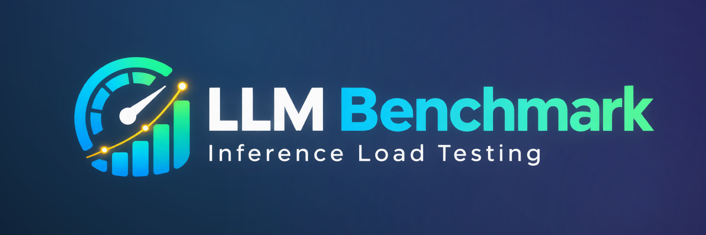

# LLM Benchmark

<p align="center">
  
</p>

网页版大模型推理**性能压测**工具。只需填入模型 API 端点，即可一键测量文本 / 视觉模型的
**TTFT（首 token 时延）、实际吞吐（tokens/s）、TPOT（每 token 时延）与并发表现**，
并支持阶梯压测、历史记录与多任务结果对比。

[English](README.md) | 中文说明


## 功能

- **多协议** —— 页面内选择 OpenAI 兼容、Anthropic、Gemini 端点。
- **三种压测方式** —— 固定并发、阶梯压测（逐级爬升并发并统计每级表现）、开环速率注入。
- **视觉模型测试** —— 附带内置示例图或上传图片，测量多模态输入的时延表现。
- **内置问题库** —— 默认样例 + 自定义文本；输入长度按目标 token 数生成。
- **自动分析** —— 阶梯压测绘制吞吐曲线，并给出饱和点、SLA 合规最大并发与推荐并发。
- **历史记录** —— 任务与每个请求明细存入 SQLite，支持多任务指标对比。
- **预设模板** —— 保存并一键恢复整套配置。
- **单端口部署** —— 后端在同一端口同时托管静态前端与 API。
- **命令行模式** —— 一条 curl 命令下载脚本即可进入交互式向导，复用同一套测量引擎，适合无图形界面的服务器。
- **中英双语界面** —— 运行时可切换。

## 指标

| 指标 | 含义 |
| --- | --- |
| TTFT | 首 token 时延，决定“打开对话要等多久”的体感 |
| TPOT | 每输出 token 耗时，反映解码流畅度 |
| ITL | 出字间隔（P50/P95） |
| 吞吐 | 单位时间输出的 token 数（tokens/s） |
| RPS | 请求完成速率 |
| 错误率 | 失败（含超时）请求占比 |

报告中给出分位数（P50/P95/P99），因为平均值会掩盖长尾时延。

## 技术栈

| 层 | 技术 |
| --- | --- |
| 后端 | FastAPI + uv（Python 3.12）、SQLAlchemy async + SQLite、httpx 流式请求、tiktoken |
| 前端 | Next.js 15（静态导出）+ React 19 + Tailwind v4 + ECharts + Zustand |
| 实时进度 | Server-Sent Events |
| 安全 | API Key 使用 Fernet 加密落库（密钥 `data/.secret.key`），返回前端前一律清空 |

## 快速开始（Docker）

推荐使用 Docker 运行，需已安装 Docker 与 Compose。

```bash
docker compose up -d --build
# 打开 http://localhost:8000
```

历史数据与密钥保存在 `llmbench-data` 卷中，重建容器不会丢失。镜像与 Dockerfile 均为多架构，
Windows / macOS（含 Apple Silicon）/ Linux 三平台通用。

自定义宿主机端口，或仅限本机访问：

```bash
LMB_UI_PORT=9000 docker compose up -d --build          # http://localhost:9000
LMB_UI_BIND=127.0.0.1 docker compose up -d --build     # 仅本机访问（Linux）
```

不使用 Compose：

```bash
docker build -t llm-benchmark .
docker run -p 8000:8000 -v llmbench-data:/data llm-benchmark
```

## 快速开始（源码运行）

### 后端

```bash
cd backend
uv sync              # 安装依赖（含 dev）
uv run llm-benchmark # 默认 127.0.0.1:8000
```

可选：用内置 mock 服务在没有真实模型时快速体验。

```bash
uv run python scripts/mock_server.py --port 8765
```

### 前端

```bash
cd frontend
npm install
npm run build
```

开发模式下保持后端运行，并把前端指向它：

```bash
# PowerShell
$env:NEXT_PUBLIC_API_BASE="http://127.0.0.1:8000"
npm run dev   # http://localhost:3000
```

单端口生产部署时，将静态产物合并进后端：

```bash
# PowerShell
Remove-Item backend/static -Recurse -Force
Copy-Item frontend/out backend/static -Recurse
uv run llm-benchmark   # 只需 8000 一个端口同时提供页面与 API
```

## 命令行使用（无界面）

在没有图形界面的服务器或纯终端里，可用一行命令启动交互式向导，无需 Web 界面。它复用同一套测量引擎
（TTFT、吞吐、TPOT、ITL、错误率）与阶梯分析。

```bash
# 交互式向导：逐步询问端点与压测配置后执行
curl -fsSL -o llm-bench.sh https://raw.githubusercontent.com/tatocode/lm_benchmark/main/llm-bench.sh
sh llm-bench.sh
```

也可以直接传参做非交互式、可脚本化的压测：

```bash
sh llm-bench.sh --base-url http://127.0.0.1:11434/v1 --model llama3 \
  --mode step --levels 1,2,4,8,16 --step-requests 10
```

如果已经 clone 了仓库，无需该脚本，直接用包内入口即可：

```bash
cd backend
uv run llm-bench --interactive
uv run llm-bench --base-url http://127.0.0.1:11434/v1 --model llama3 \
  --mode fixed --concurrency 8 --requests 50
```

常用参数：`--protocol openai|anthropic|gemini`、`--mode fixed|step|open`、
`--concurrency`、`--requests`、`--levels`、`--step-requests`、`--arrival-rate`、
`--duration`、`--input-tokens`、`--max-output-tokens`、`--timeout`、`--image`、
`--json`（机器可读输出）、`--fail-over <rate>`（超阈值时以退出码 3 结束，便于 CI）。

注意：

- 需要 `python3` 3.12+（或已安装 `uvx`/`uv`，可自动准备合适的运行时）。启动脚本会优先使用 `uvx`/`uv`，其次 `pipx`，最后回退到临时 `venv`。
- 用环境变量 `LMB_API_KEY` 传入密钥，避免出现在 shell 历史里。
- 请以 `sh llm-bench.sh` 方式运行下载的脚本（不要用 `curl … | sh`），否则交互提示无法读取终端。

## 使用方式

1. **连接模型** —— 选择协议，填写 Base URL 与模型名称（可点「获取模型列表」自动发现）。
   连通性会自动检测；本地服务通常无需 API Key。
2. **选择压测方式** —— 可直接点选推荐场景（单流延迟、吞吐摸底、极限探测、真实流量），
   或手动配置压测方式。
3. **（可选）高级设置** —— 输入长度、Max 输出 Tokens、单请求超时、SLA 阈值与视觉测试。
4. **开始压测** —— 监控页实时展示进度（吞吐、时延、错误率）；完成后结论卡给出推荐并发、
   饱和点与每档时延对比。历史任务可在「历史记录」中查看与对比。

## 配置

### 后端环境变量

| 变量 | 默认 | 说明 |
| --- | --- | --- |
| `LMB_HOST` | `127.0.0.1` | 监听地址（Docker 内为 `0.0.0.0`） |
| `LMB_PORT` | `8000` | 监听端口 |
| `LMB_DATA_DIR` | `./data` | SQLite 与密钥目录 |
| `LMB_STATIC_DIR` | `./static` | 前端静态产物目录（含 `index.html` 时启用托管） |
| `LMB_MAP_LOCALHOST_HOST` | 空 | 非空时（如 `host.docker.internal`），出站 `localhost` / `127.0.0.1` 请求会映射到该地址 |
| `LMB_IN_DOCKER` | 空 | `1` / `true` 表示运行在容器内；未显式配置上一项时自动映射 localhost |
| `LMB_UI_PORT` | `8000` | 宿主机侧网页端口（`docker compose` 时生效） |
| `LMB_UI_BIND` | `0.0.0.0` | 宿主机侧监听地址（`docker compose` 时生效） |

### 前端环境变量

| 变量 | 说明 |
| --- | --- |
| `NEXT_PUBLIC_API_BASE` | API 基址，默认同源；开发模式设为 `http://127.0.0.1:8000` |

## 从容器压测「当前机器」上的 LLM

容器默认把出站 `localhost` / `127.0.0.1` 映射到宿主机，页面里照填 `http://localhost:11434/v1`
这类本机地址即可（存储与展示仍是你填的原文）。

| 平台 | 为什么能直达宿主机 | 需要注意 |
| --- | --- | --- |
| Windows（Docker Desktop） | 原生 `host.docker.internal` | —— |
| macOS（Docker Desktop / OrbStack） | 原生 `host.docker.internal` | —— |
| Linux（Docker ≥ 20.10） | compose 已配 `extra_hosts: host.docker.internal:host-gateway` | 本机服务若只监听 `127.0.0.1`，容器侧进不去：请让它监听 `0.0.0.0`（Ollama 设 `OLLAMA_HOST=0.0.0.0`；vLLM / llama.cpp 加 `--host 0.0.0.0`），或改 `LMB_MAP_LOCALHOST_HOST` 指向宿主机网卡 IP |

不压本机时，直接在页面填写远端地址即可，容器可正常出站访问局域网与外网。

## 测试

```bash
cd backend && uv run pytest -q
cd frontend && npm run lint && npm run build
```

## 致谢

本项目在开发过程中借助开源 AI 编程助手 [opencode](https://opencode.ai) 完成。项目同样建立在
众多优秀开源工作之上，包括 FastAPI、SQLAlchemy、httpx、tiktoken、Next.js、React、
Tailwind CSS、ECharts 与 Radix UI，在此向这些项目的维护者与贡献者致以感谢。

## 许可证

本项目基于 [MIT 许可证](LICENSE) 开源。
